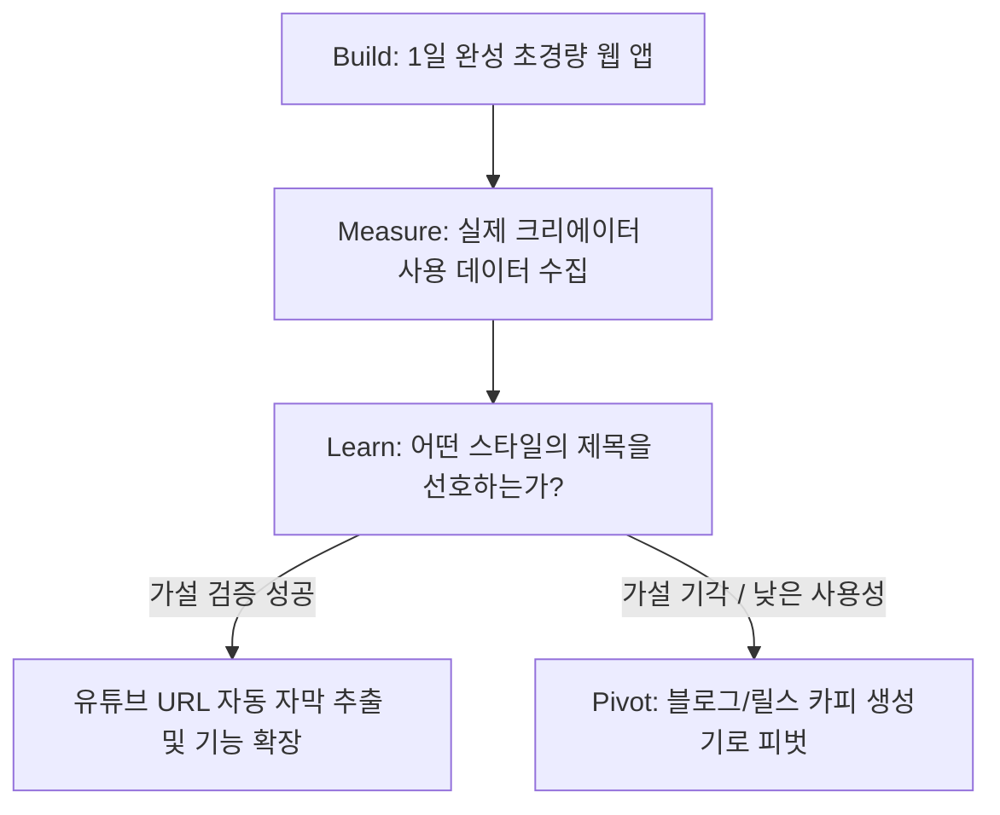

# 🚀 [Lean Startup PRD] 유튜브 자막 기반 썸네일 카피 & 제목 생성기

**프로젝트 코드명**: TubeHook (가칭)  
**핵심 철학**: 가장 적은 리소스로 크리에이터의 '제목/썸네일 짓기 페인포인트'에 대한 시장 수요(PMF)를 검증한다.

---

## 1. 린 스타트업 문제 정의 & 가설 (Problem & Hypotheses)

### 1.1 핵심 문제 (Pain Point)
* **시간 낭비**: 크리에이터는 영상 제작 완료 후 제목과 썸네일 문구를 고민하는 데 평균 1~2시간을 소모함.
* **낮은 클릭률(CTR)**: 영상 본문(자막)에 핵심 후킹 포인트가 있음에도, 이를 객관적으로 추출하지 못해 밋밋한 제목을 지음.
* **피로도**: 자막 파일(SRT, VTT, 대본)은 이미 완성되어 있지만 이를 활용할 빠르고 쉬운 툴이 없음.

### 1.2 핵심 검증 가설 (Core Hypotheses)
1. **가치 가설 (Value Hypothesis)**  
   * *"크리에이터는 자막을 넣고 5초 안에 썸네일 문구와 제목 10종을 추천받으면, 그중 1개 이상을 실제 유튜브 업로드에 채택할 것이다."*
2. **성장 가설 (Growth Hypothesis)**  
   * *"자막 기반 카피 생성 결과를 카카오톡/디스코드/크리에이터 커뮤니티에 원클릭 공유하거나 입소문으로 주간 20% 이상 자연 유입(Organic)이 발생할 것이다."*

---

## 2. 린 캔버스 (Lean Canvas 1-Page)

| 구성 요소 | 내용 |
| :--- | :--- |
| **1. 문제 (Problem)** | • 영상 업로드 직전 제목/썸네일 카피 창작 고통<br>• CTR(클릭률) 낮은 평범한 제목 작성 |
| **2. 고객군 (Customer)** | • 얼리어답터: 주 1회 이상 영상 올리는 1인 유튜버/쇼츠 크리에이터<br>• 확장 타겟: 채널 운영 대행사, 전문 영상 편집자 |
| **3. 고유 가치 제안 (UVP)** | **"자막 파일만 드래그하세요. 알고리즘과 시청자를 저격하는 썸네일 문구 & 제목 10종이 3초 만에 완성됩니다."** |
| **4. 해결책 (Solution)** | SRT/VTT/스크립트 텍스트 분석 기반 스타일별(자극/호기심/정보/스토리) 후킹 타이틀 자동 생성 |
| **5. 채널 (Channels)** | 영상 편집자 오픈채팅방, 디시인사이드 유튜브 갤러리, 크리에이터 디스코드 |
| **6. 수익 모델 (Revenue)** | • MVP 단계: 100% 무료 (전환율 및 리텐션 검증)<br>• 차후 단계: 월 구독(무제한 생성, 썸네일 이미지 AI 생성) |
| **7. 비용 구조 (Cost)** | AI LLM 추론 비용(Gemini Flash / GPT-4o-mini 사용 시 건당 1~2원 수준), 호스팅(Vercel 무료 티어) |
| **8. 핵심 지표 (Metrics)** | • 결과물 복사율(Copy Rate, 목표: 60% 이상)<br>• 재방문율(D+7 Retention, 목표: 25% 이상) |
| **9. 경쟁 우위 (Unfair Advantage)** | 단순 대화형 AI(ChatGPT)와 달리 자막 전용 파서 및 썸네일 레이아웃 실시간 미리보기 제공 |

---

## 3. MVP 범위 정의 (Minimum Viable Product Scope)

린 스타트업의 원칙에 따라 **"가장 최소한의 것만 만들고, 불필요한 것은 철저히 배제"**합니다.

```
[포함 (Must-Have for MVP)]
 ✅ 자막 파일 드롭(.srt, .vtt) 또는 대본 복사/붙여넣기
 ✅ 자막 타임스탬프 자동 정제 (파서)
 ✅ 4개 스타일별 제목 8개 + 썸네일 2~4단어 카피 4개 생성
 ✅ 원클릭 클립보드 복사
 ✅ 가상 썸네일 캔버스 미리보기 (폰트/문구 체감용)
 ✅ 피드백 수집 위젯 ("이 제목 쓸만했나요? 👍 / 👎")

[제외 (Nice-to-Have -> 검증 후 개발)]
 ❌ 회원가입 / 로그인 (이탈 방지를 위해 초기엔 비회원 즉시 사용)
 ❌ 결제 시스템
 ❌ 유튜브 API 연동 계정 관리
 ❌ 복잡한 영상 렌더링 서버
```

---

## 4. 빌드-측정-학습 (Build - Measure - Learn) 피드백 루프



### 4.1 Build (만들기: 24시간 내 구현 목표)
* **프론트엔드 단독 구조**: 별도 서버 구축 없이 브라우저 상에서 동작
* **저비용 AI API**: Google Gemini 1.5 Flash 또는 GPT-4o-mini 연동
* **무료 모드 기본 내장**: API 키 없이도 동작하는 키워드 기반 기본 추천 엔진 포함

### 4.2 Measure (측정하기: 실행 지표 정의)
* 허영 지표(방문자 수)를 배제하고 **행동 지표(Actionable Metrics)**에 집중:
  1. **생성 완료율**: 방문자 중 자막을 입력하고 '생성하기'를 누른 비율 (목표: > 40%)
  2. **복사율 (Copy Rate)**: 생성된 결과 중 '복사' 버튼을 1회 이상 누른 비율 (목표: > 60%)
  3. **선호 스타일**: 충격/자극형 vs 호기심형 vs 정보형 중 어떤 타입의 복사가 가장 많은가?
  4. **만족도 투표**: 하단 "실제 영상에 적용하시겠습니까?" (Yes/No)

### 4.3 Learn (학습하기: 의사결정 기준)
* **계속 진행 (Persevere)**: 복사율 50% 이상 & 주간 재사용률 20% 이상 시 ➔ 유튜브 URL 바로 넣기 및 썸네일 이미지 AI 생성 추가
* **방향 전환 (Pivot)**:
  * "자막 파일 추출이 귀찮다"는 의견 다수 ➔ 유튜브 링크만 넣으면 돌아가는 구조로 즉시 전환
  * "쇼츠 텍스트로 쓰고 싶다" ➔ 유튜브 쇼츠/릴스 전용 후킹 첫 3초 대본 생성기로 피벗

---

## 5. 기능 명세서 (Functional Specification)

### Screen 1. 입력 화면 (Input View)
1. **자막 입력 영역**:
   - 텍스트 입력창 (대본/스크립트 직접 붙여넣기)
   - 파일 업로드 존 (.srt, .vtt 파일 드래그 앤 드롭)
2. **카테고리 선택 칩 (Chip Buttons)**:
   - [전체] [지식/정보] [이슈/엔터] [브이로그/일상] [테크/리뷰]
3. **[🔥 3초 만에 제목 & 썸네일 카피 뽑기] CTA 버튼**

### Screen 2. 결과 및 미리보기 화면 (Result & Preview View)
1. **썸네일 문구 섹션 (Thumbnail Copy)**:
   - 2~4단어 압축 문구 4종
   - 클릭 시 우측 '가상 썸네일 미리보기'에 즉시 텍스트 합성 렌더링
2. **유튜브 추천 제목 섹션 (Titles)**:
   - 스타일 탭: [💥 자극형] [❓ 호기심형] [💡 정보형] [🎬 반전/스토리형]
   - 각 타이틀 옆 [복사] 버튼 및 클릭 시 토스트 알림 ("복사되었습니다!")
3. **가상 썸네일 미리보기 캔버스**:
   - 16:9 비율의 시각적 박스
   - 검정/빨강/노랑 배경 선택 및 선택한 썸네일 폰트 오버레이
4. **검증용 피드백 버튼**:
   - "이 결과가 마음에 드셨나요?" [👍 유용해요] [👎 아쉬워요]

---

## 6. 다음 단계 실행 계획 (Next Action)

1. **설계서 확정**
2. **MVP 단일 웹 애플리케이션 즉시 개발**
3. **로컬 테스트 및 브라우저 검증**
